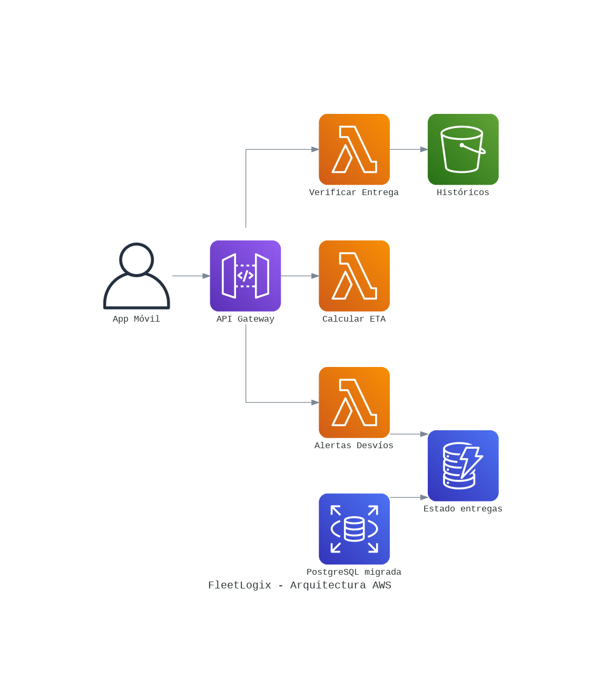

# FleetLogix — Data Engineering & Analytics

Proyecto de Data Science / Data Engineering desarrollado durante el Módulo 2 de Henry. El caso simula una empresa logística y recorre el flujo desde la generación y almacenamiento de datos operacionales hasta el análisis SQL, el modelado dimensional, un pipeline ETL hacia Snowflake y el análisis de una arquitectura cloud en AWS.

## Objetivos

- Generar datos sintéticos respetando relaciones y reglas de negocio.
- Diseñar una base operacional en PostgreSQL.
- Resolver consultas analíticas y optimizar su rendimiento mediante índices.
- Diseñar un modelo dimensional tipo estrella para análisis.
- Implementar un pipeline ETL PostgreSQL → Snowflake.
- Analizar una arquitectura AWS para escalar la solución.

## Tecnologías

Python · SQL · PostgreSQL · Snowflake · AWS · Pandas · NumPy · psycopg2 · boto3

## Estructura del repositorio

```text
fleetlogix-data-engineering/
├── data_generation/
│   └── generate_data.py
├── sql/
│   ├── database_schema.sql
│   ├── analytical_queries.sql
│   ├── additional_queries.sql
│   ├── optimization_indexes.sql
│   └── dimensional_model.sql
├── etl/
│   └── etl_pipeline.py
├── aws/
│   ├── aws_setup.py
│   └── lambda_functions.py
├── images/
│   └── aws_architecture_diagram.png
├── docs/
├── .env.example
├── .gitignore
└── requirements.txt
```

## Flujo del proyecto

### 1. Generación y base operacional
`data_generation/generate_data.py` genera datos sintéticos para vehículos, conductores, rutas, viajes, entregas y mantenimiento, utilizando semillas para reproducibilidad. El esquema de PostgreSQL se encuentra en `sql/database_schema.sql`.

### 2. Análisis y optimización SQL
`sql/analytical_queries.sql` y `sql/additional_queries.sql` contienen las consultas de análisis del caso. `sql/optimization_indexes.sql` incorpora índices orientados a mejorar el rendimiento de las consultas.

### 3. Data Warehouse y ETL
`sql/dimensional_model.sql` define el modelo dimensional para Snowflake. `etl/etl_pipeline.py` implementa la extracción desde PostgreSQL, las transformaciones y la carga en Snowflake.

### 4. Arquitectura AWS
La carpeta `aws/` contiene scripts del análisis/prototipo de servicios AWS, incluyendo RDS, S3, DynamoDB y Lambda. La arquitectura propuesta se resume en el siguiente diagrama:



## Configuración segura

Las credenciales no se incluyen en el repositorio. Copiá `.env.example` a `.env` y completá tus propias variables de entorno antes de ejecutar los scripts. `.env` está excluido mediante `.gitignore`.

> Nota: los scripts de AWS forman parte de un proyecto académico. Antes de desplegar recursos reales, revisá permisos, costos, seguridad de red y configuración de cada servicio.

## Documentación

La carpeta `docs/` conserva la documentación técnica y los entregables desarrollados durante el proyecto.

## Autora

Verónica Sofía Iacono — Data Analyst & Data Scientist Jr.
